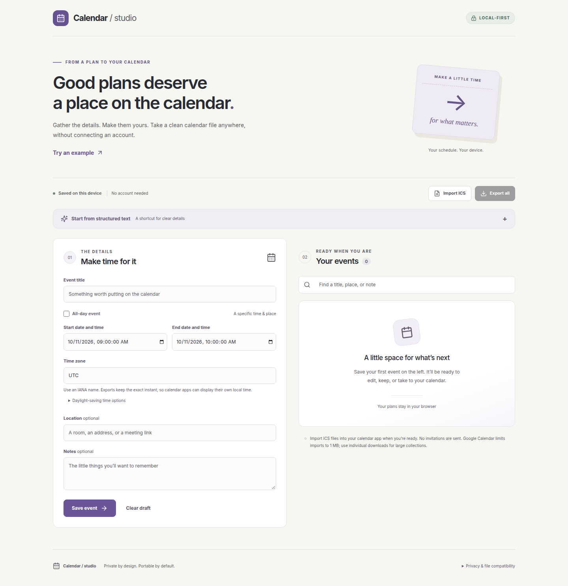
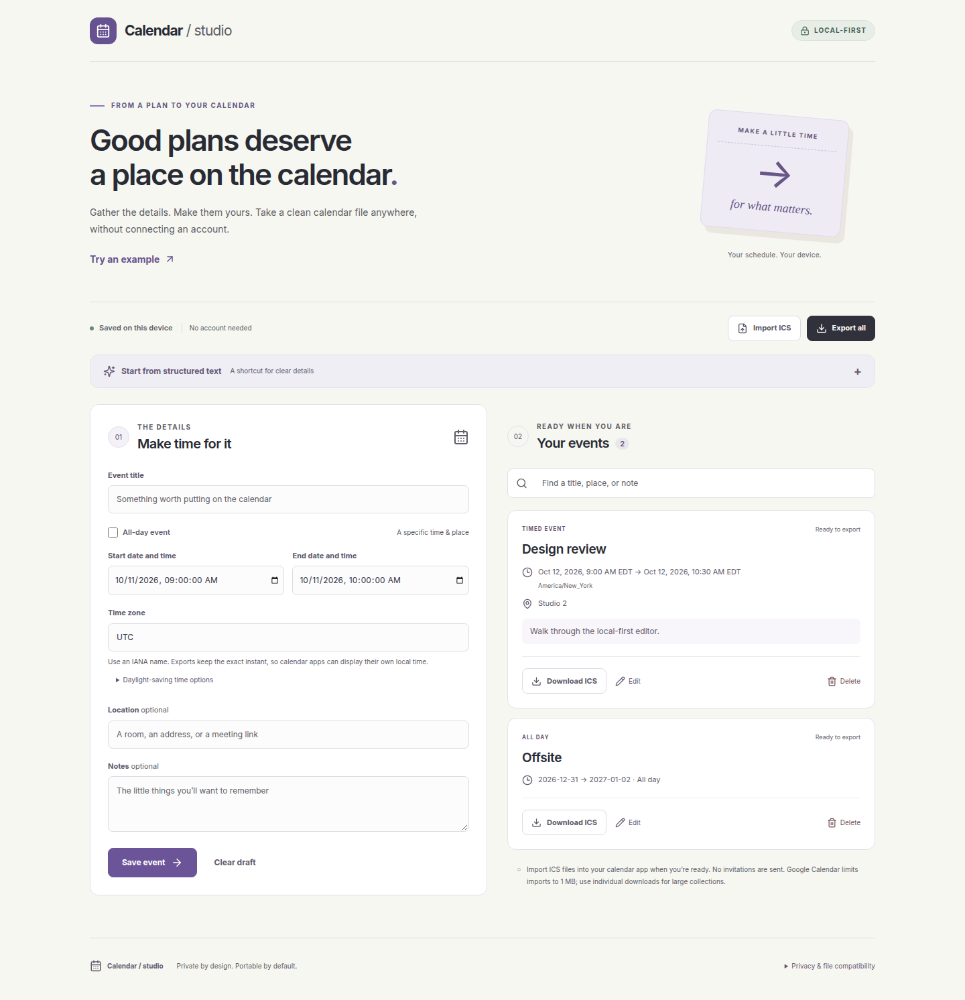
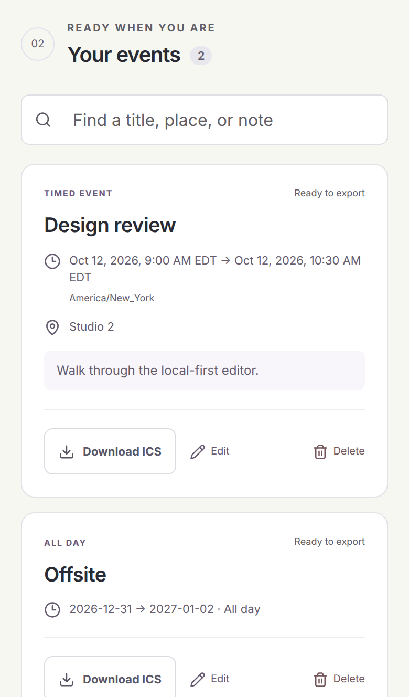

# Calendar / studio

A local-first browser tool for turning explicit event details into editable events and a portable [iCalendar](https://www.rfc-editor.org/rfc/rfc5545) file. Events stay in the browser until you download them. The app does not connect a calendar account, call an AI provider, or send invitations.

## Screenshots

These are the production build, captured locally with Playwright. The first screen is the empty studio. The next two show a timed design review and an all-day offsite saved on the device.







Regenerate them from the production build with `node scripts/capture-screenshots.mjs`. That command needs the system Chrome path in `PLAYWRIGHT_CHROMIUM_EXECUTABLE_PATH` when Playwright’s downloaded browser is not installed.

## What works

- Create, edit, search, delete, and undo the last deletion.
- Timed events with named IANA time zones, strict date/end-order validation, and separate start/end choices when daylight-saving time repeats an hour. Nonexistent local times are rejected.
- All-day events with an inclusive **Last day** in the editor and the RFC-required exclusive `DTEND` in the file.
- Individual or full-collection ICS downloads, including Unicode, multiline notes, safe escaping, stable UIDs, edit sequence numbers, and UTF-8-aware 75-octet folding.
- Review-before-add ICS import for the supported subset below. Re-imported UIDs are skipped so existing edits are not overwritten.
- Versioned, validated browser persistence. Corrupt/blocked storage and cross-tab changes produce an explicit warning and preserve in-tab work for download.
- Responsive keyboard-accessible editor, search, status/error feedback, unsaved-edit confirmation, and native date/time inputs.

## Start locally

Requires Node 22.12+ (Node 24 recommended).

```sh
npm ci
npm run dev
```

The default development URL is printed by Vite. For a production-build preview:

```sh
npm run build
npm run preview
```

Serve `dist/` over HTTP(S). Relative asset paths also support a private subdirectory preview. No hosting account or backend is required. `vercel.json` only declares response headers for a future static host; nothing in this repository deploys the app or connects a calendar account.

The production response headers live in `vercel.json`. The production build copies the fetch directives into a meta Content Security Policy: same-origin scripts, styles, and images; no network connections, objects, embeds, form posts, inline event handlers, or inline style attributes. `frame-ancestors` and `upgrade-insecure-requests` stay on the response header. A meta tag ignores framing directives, and the local preview is plain HTTP, where `upgrade-insecure-requests` would retarget the page to HTTPS. `npm run preview` and the browser tests send the remaining production headers.

## Explicit text shortcut

Open **Start from structured text** and use:

```text
Design review | 2026-10-12 | 09:00-10:30 | America/New_York | Studio 2
Offsite | 2026-12-31..2027-01-02 | all-day
Overnight work | 2026-10-12..2026-10-13 | 23:00-01:00 | UTC
```

The zone and location are optional; an omitted zone is **UTC**. The parser fills an editable draft for review. It does not interpret arbitrary natural language, relative dates, or ambiguous shorthand.

**External AI is not configured, implemented, or verified in this version.** The previous browser-side provider calls, provider SDK, and key-entry/settings code are removed. This local workflow does not require an AI provider. Secure arbitrary-language extraction would require a separately authorized server-side integration; it is not simulated here.

## Privacy and persistence

- No API keys, external AI requests, analytics, invitations, or calendar-account writes.
- Event content stays in the browser until the user downloads a file. Files selected for import are parsed locally.
- Production Content Security Policy blocks network connections (`connect-src 'none'`). UI assets are served from the same origin.
- Saved data is **not encrypted**. Other users of the browser profile can access it. Local storage is not a backup and is not synchronized across devices.
- Storage uses only `ces_events_v1`. This version does not read old provider settings (`app_settings`) or credentials. Old event/settings data is left untouched and is not automatically migrated; old events can be exported from the prior version and imported when they fit the supported ICS subset. Remove any previously stored credentials through the browser’s site-data controls.
- If storage is corrupt on startup, it is never overwritten. New work stays in memory. If a write fails, an explicit warning asks for an ICS backup before leaving. Cross-tab storage changes put that tab into non-overwriting mode; download any new work and reload.
- Up to 500 events are supported. Title, location and notes have bounded lengths. ICS imports are capped at 40 MB, sufficient for an export of the maximum supported collection. Browser storage quotas can be smaller; download backups when warned.
- The former PWA/service-worker registration is removed. This version makes no installable/offline-reload promise. If testing at an origin that ran the older PWA, unregister that old worker and reload the page so it cannot serve stale old code. No existing production deployment is modified by this branch.

## Calendar format & import boundaries

Exports follow [RFC 5545](https://www.rfc-editor.org/rfc/rfc5545) for `VCALENDAR`/`VEVENT`, UTF-8 folding, escaped TEXT values, CRLF content lines and date boundaries. Timed events are emitted in UTC; the optional `X-CES-TIMEZONE;VALUE=TEXT` extension preserves this editor’s display zone on round-trip. A receiving calendar may display the event in its own timezone. No `METHOD`, organizer, or attendees are emitted.

The importer uses [ICAL.js](https://kewisch.github.io/ical.js/api/) with strict schema and lexical validation. It supports standalone non-recurring `VEVENT`s, UTC or matching explicit IANA `TZID` start/end values, and all-day `DATE` values. Timed events need an explicit end. A date-only event without an end is one day. An ambiguous imported local time is rejected; represent its resolved instant as UTC.

To avoid silently losing meaning, import rejects recurrence rules/exceptions, invitations, organizers/attendees, alarms, tasks/journals, `VTIMEZONE` components, floating times, duration-only events, unexpected properties/parameters, duplicate properties/UIDs, and malformed data. No partial import is committed. Therefore many full calendar exports from other apps require simplification; this is an event-file editor, not a full calendar synchronizer. Calendar-product account imports were not exercised against real accounts. Recipient apps have their own limits: [Google Calendar caps imports at 1 MB](https://support.google.com/calendar/answer/45654?hl=en). Use individual event downloads for large collections; the 40 MB limit is this app’s own backup/import limit.

Timezone resolution uses [Temporal](https://tc39.es/proposal-temporal/docs/zoneddatetime.html) and the browser’s timezone database. Dates must use Gregorian years 0001–9999; leap-second `:60` values are explicitly unsupported. Exported end dates must stay within that range.

## Security status

`npm run check:headers` checks `vercel.json` against the [securityheaders.com](https://securityheaders.com/) grade A rubric and serves those headers on loopback to confirm they round-trip. The local result is an expected grade of **A**: Content-Security-Policy with no script or style `unsafe-inline` / `unsafe-eval`, Strict-Transport-Security (`max-age=63072000; includeSubDomains`), `X-Content-Type-Options: nosniff`, `X-Frame-Options: DENY`, `Referrer-Policy: no-referrer`, and a Permissions-Policy that denies unused browser features. The securityheaders.com grade is **unverified**. That scanner grades a live HTTPS response, and this repository ships the header configuration for a future static host. HSTS leaves out `preload` until a production hostname is submitted to the [preload list](https://hstspreload.org/), which is the extra requirement for grade A+.

CI runs `npm audit --audit-level=high`. The committed lockfile has no high or critical advisories. `.github/dependabot.yml` asks Dependabot for weekly npm and GitHub Actions updates.

## Verification

```sh
npm run check          # strict lint, unit/component tests, TypeScript, production build, header rubric
npm run validate:ics   # committed docs/sample-calendar.ics matches the generator and parses
npx playwright install chromium
npm run test:browser   # desktop + mobile Chromium, one worker, sandbox enabled
npm audit --audit-level=high
```

`docs/sample-calendar.ics` is generated from two synthetic events (a New York design review and an all-day offsite). `npm run validate:ics` checks CRLF endings, the 75-octet line limit, component boundaries, `VERSION:2.0`, and a round trip through both [ICAL.js](https://kewisch.github.io/ical.js/api/) and this app’s importer. Opening that file in Google Calendar is a separate manual check; automated validation does not substitute for it.

GitHub Actions runs lint, unit tests, the production build, the ICS file check, both browser projects, and a [gitleaks](https://github.com/gitleaks/gitleaks) history scan on each branch commit and pull request.

For an existing trusted Chromium installation set `PLAYWRIGHT_CHROMIUM_EXECUTABLE_PATH` to its path. The test configuration keeps Chromium sandboxing on. Browser tests run against the production build on loopback port 4193 and use only synthetic events. No real provider calls, credentials, calendar writes, or invitations are involved.

Tests exercise invalid/leap dates, DST gaps/folds and overlap edits, non-hour timezones, all-day boundaries, property injection/escaping/Unicode line folding, independent ICAL parsing, round trips, malformed imports, large backups, duplicate imports, persistence failures/corruption, repeated edits, delete/undo, cancelled changes, real downloads, responsive width, and keyboard navigation.
